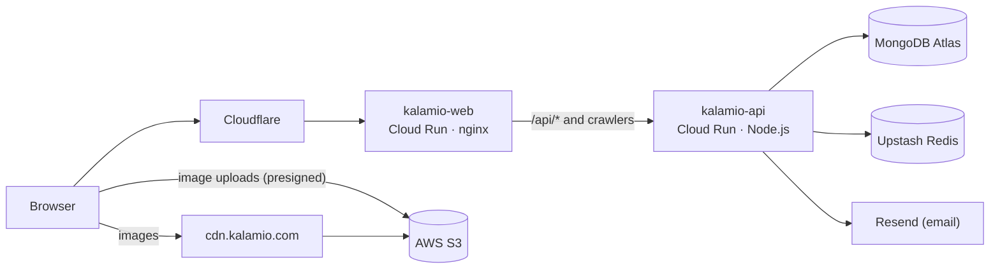

# Deployment

How [kalamio.com](https://kalamio.com) is deployed, and what you need to run Kalamio in production.
For local development, see [CONTRIBUTING.md](../CONTRIBUTING.md) instead.

## Architecture



| Service | What it does |
|---|---|
| **kalamio-web** | nginx serving the built React app. Proxies `/api/` to the API, and sends social-media crawlers to the API's prerender endpoint so shared links get rich previews. |
| **kalamio-api** | Express REST API and Socket.IO server. |
| **MongoDB Atlas** | Primary database. |
| **Upstash Redis** | Response caching (REST API) and Socket.IO broadcast across instances (Redis protocol). |
| **AWS S3 + CDN** | Uploaded images, served through `cdn.kalamio.com`. |
| **Resend** | Outgoing email (sign-up and password-reset codes) over SMTP. |

## Environments and releases

| Environment | Cloud Run services | Deployed when | Build config |
|---|---|---|---|
| Development (`dev.kalamio.com`) | `kalamio-web-development`, `kalamio-api-development` | a pull request is merged into `main` | `cloudbuild-*-dev.yaml` |
| Production (`kalamio.com`) | `kalamio-web`, `kalamio-api` | a GitHub release is published | `cloudbuild-*-prod.yaml` |

Each Cloud Build trigger only runs when its part of the repo changed (`frontend/` or `server/`).
Release tags are protected: only repository admins can create them, so only admins can deploy to production.

## Configuration

The API reads its configuration from environment variables. [`server/.env.example`](../server/.env.example)
documents every variable, with local defaults and notes on the production value.

| Variable | Production value |
|---|---|
| `DB_LOCATION` | MongoDB Atlas connection string (`mongodb+srv://…`) |
| `JWT_ACCESS_SECRET`, `JWT_REFRESH_SECRET` | Long random strings, different per environment |
| `FRONTEND_URL` | `https://kalamio.com` (or the dev domain) |
| `AWS_ACCESS_KEY`, `AWS_SECRET_ACCESS_KEY`, `AWS_REGION`, `AWS_BUCKET` | S3 credentials and bucket. Leave `S3_ENDPOINT` unset. |
| `CDN_DOMAIN` | `https://cdn.kalamio.com` (set by the deploy config) |
| `SMTP_HOST`, `SMTP_PORT`, `EMAIL_USER`, `EMAIL_PASS`, `EMAIL_FROM` | Resend: `smtp.resend.com`, `465`, `resend`, the API key, `no-reply@kalamio.com` |
| `GOOGLE_CLIENT_ID`, `GOOGLE_CLIENT_SECRET`, `GOOGLE_CALLBACK_URL` | Google OAuth credentials (optional; enables Google sign-in) |
| `UPSTASH_REDIS_REST_URL`, `UPSTASH_REDIS_REST_TOKEN` | Response cache (optional), from Secret Manager |
| `REDIS_URL` | Upstash Redis protocol URL (`rediss://…`), from Secret Manager. Required when running more than one API instance. |
| `CLOUDFLARE_ORIGIN_SECRET` | Origin lock (optional), from Secret Manager |

The web app is configured at build time: `VITE_SERVER_DOMAIN` (the API's public URL, with a trailing
slash) and `VITE_CDN_DOMAIN` are passed as build arguments by `cloudbuild-web-*.yaml`.

### Secrets

Secrets live in Google Secret Manager. Development uses the same names with a `-dev` suffix.

| Secret | Used by |
|---|---|
| `upstash-redis-rest-url`, `upstash-redis-rest-token` | API response cache |
| `redis-url` | API Socket.IO adapter |
| `cloudflare-origin-secret` | API origin lock |
| `resend-api-key` | API email (`EMAIL_PASS`) |
| `web-dev-htpasswd` | Password protection for `dev.kalamio.com` |

A deploy that references a missing secret fails, so create secrets **before** the first deploy that
uses them. The runtime service account needs `roles/secretmanager.secretAccessor` on each one.

## Response caching (Upstash Redis)

Public read endpoints are cached in Upstash Redis. **Caching is optional**: with no credentials set,
the API behaves normally. Locally, add to `server/.env`:

```
UPSTASH_REDIS_REST_URL=https://<your-db>.upstash.io
UPSTASH_REDIS_REST_TOKEN=<your-rest-token>
```

**On Cloud Run** the API deploy configs (`cloudbuild-api-*.yaml`) mount these from Secret Manager.
Create the secrets **before deploying** (a deploy referencing a missing secret fails), then grant the
runtime service account read access:

```bash
# prod (dev uses the same names with a -dev suffix)
printf '%s' "https://<db>.upstash.io" | gcloud secrets create upstash-redis-rest-url   --data-file=-
printf '%s' "<rest-token>"            | gcloud secrets create upstash-redis-rest-token --data-file=-

SA=$(gcloud run services describe kalamio-api --region us-central1 \
       --format='value(spec.template.spec.serviceAccountName)')   # or the default compute SA
for s in upstash-redis-rest-url upstash-redis-rest-token; do
  gcloud secrets add-iam-policy-binding "$s" \
    --member="serviceAccount:$SA" --role="roles/secretmanager.secretAccessor"
done
```

Use a **separate Upstash database for dev and prod** so their caches don't collide.

## Cloudflare origin lock (optional)

If the API runs behind Cloudflare, set `CLOUDFLARE_ORIGIN_SECRET` so requests that bypass Cloudflare
(hitting `*.run.app` directly) are rejected. In Cloudflare, add a **Transform Rule → Modify Request
Header** that sets `X-Origin-Secret` to the same value on origin requests. The API deploy configs
mount it from Secret Manager (`cloudflare-origin-secret`, `-dev` for dev):

```bash
printf '%s' "<long-random-value>" | gcloud secrets create cloudflare-origin-secret --data-file=-
# grant the runtime service account secretAccessor (same as the Upstash secrets)
```

It's a **no-op until set**, so it can ship before Cloudflare is in front. Keep Cloudflare on its
default caching (respect origin `Cache-Control`). Do **not** enable "Cache Everything": the API
defaults to `no-store` and opts specific public GETs into edge caching itself.

## Development site password (dev.kalamio.com)

`dev.kalamio.com` is behind HTTP Basic Auth. The users file is **not in git**: it lives in Secret
Manager as `web-dev-htpasswd`, and `cloudbuild-web-dev.yaml` mounts it into Cloud Run at
`/etc/nginx/auth/htpasswd`. To add or change a user, generate a line and add a new secret version:

```bash
printf '%s' '<password>' | openssl passwd -apr1 -stdin   # → put "username:<hash>" in the file
gcloud secrets versions add web-dev-htpasswd --data-file=frontend/.htpasswd
```

Then redeploy `kalamio-web-development`. The runtime service account needs
`roles/secretmanager.secretAccessor` on the secret (same as the Upstash secrets).

## Running Kalamio elsewhere

Nothing in the code is tied to Google Cloud. To self-host:

- Run the API from [`server/Dockerfile`](../server/Dockerfile) on any container platform, with the
  variables above. Use more than one instance only with `REDIS_URL` set.
- Build the web app from [`frontend/Dockerfile`](../frontend/Dockerfile) with `VITE_SERVER_DOMAIN`
  pointing at your API. Its `nginx.conf` is written for kalamio.com's domains, so adjust the
  `server_name` blocks and upstream URLs for yours.
- For storage other than AWS S3, set `S3_ENDPOINT`. Image URLs are built as
  `<S3_ENDPOINT>/<bucket>/<key>`, so the bucket must be publicly readable at that address (as it is
  with MinIO or RustFS). Providers that serve public files from a different domain need a code change.
