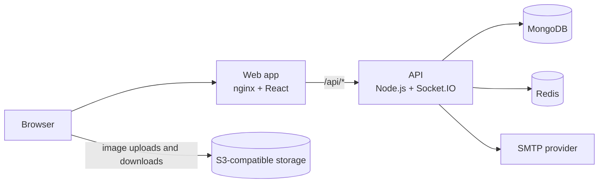

# Self-hosting

How to run your own Kalamio instance in production. For local development, see
[CONTRIBUTING.md](../CONTRIBUTING.md) instead.

## Overview

Kalamio is two services plus a few backing services:



| Component | Required | Notes |
|---|---|---|
| **API** ([`server/`](../server)) | Yes | Express REST API and Socket.IO server, Node.js 20 or newer |
| **Web app** ([`frontend/`](../frontend)) | Yes | Static React build, served by nginx in the Docker image |
| **MongoDB** | Yes | Self-managed or hosted (tested with MongoDB 7) |
| **Object storage** | Yes | AWS S3 or a compatible service, for uploaded images |
| **SMTP provider** | Yes | Sends sign-up and password-reset codes |
| **Redis** | When running more than one API instance | Broadcasts real-time events between instances |
| **Google OAuth** | No | Enables "Continue with Google" |
| **Upstash Redis (REST)** | No | Caches public read endpoints |

## Running with Docker

Both services ship with production Dockerfiles.

**API:** configure it with environment variables (see [Configuration](#configuration)), then:

```bash
docker build -t kalamio-server ./server
docker run -p 8080:8080 --env-file server/.env kalamio-server
```

It listens on port 8080 and answers `GET /health` for health checks.

**Web app:** the API's public URL is baked in at build time:

```bash
docker build -t kalamio-frontend \
  --build-arg VITE_SERVER_DOMAIN=https://your-domain.com/ \
  ./frontend
docker run -p 8080:8080 kalamio-frontend
```

`VITE_SERVER_DOMAIN` must end with a slash. Optionally pass `VITE_CDN_DOMAIN` to serve images
through a CDN (see [Images and storage](#images-and-storage)).

The image's [`nginx.conf`](../frontend/nginx.conf) is written for kalamio.com: edit its
`server_name` blocks and the API upstream URLs to match your domain before building. It serves the
app, proxies `/api/` to the API, and sends social-media crawlers to the API's prerender endpoint so
shared links get rich previews.

**Without Docker:** run the API with `npm ci --omit=dev && npm start` in `server/`. Build the web
app in `frontend/` with `npm ci && VITE_SERVER_DOMAIN=https://your-domain.com/ npm run build`, then
serve `frontend/dist/` from any web server that falls back to `index.html` for unknown paths and
proxies `/api/` to the API.

## Configuration

The API reads environment variables. [`server/.env.example`](../server/.env.example) documents every
one of them, with local defaults.

| Variable | Description |
|---|---|
| `DB_LOCATION` | MongoDB connection string |
| `JWT_ACCESS_SECRET`, `JWT_REFRESH_SECRET` | Long random strings. Generate them; never reuse the examples. |
| `FRONTEND_URL` | Your public site URL, used for redirects and CORS |
| `NODE_ENV` | Set to `production` |
| `AWS_ACCESS_KEY`, `AWS_SECRET_ACCESS_KEY`, `AWS_REGION`, `AWS_BUCKET` | Storage credentials and bucket |
| `S3_ENDPOINT` | Only for S3-compatible storage other than AWS (see below) |
| `CDN_DOMAIN` | Optional CDN in front of the bucket, e.g. `https://cdn.example.com` |
| `SMTP_HOST`, `SMTP_PORT`, `EMAIL_USER`, `EMAIL_PASS` | SMTP server and credentials. Port 465 uses TLS. |
| `EMAIL_FROM` | Visible sender address. Defaults to `EMAIL_USER`. |
| `REDIS_URL` | Redis connection string (`redis://` or `rediss://`). Required with more than one API instance. |
| `GOOGLE_CLIENT_ID`, `GOOGLE_CLIENT_SECRET`, `GOOGLE_CALLBACK_URL` | Optional Google sign-in |
| `UPSTASH_REDIS_REST_URL`, `UPSTASH_REDIS_REST_TOKEN` | Optional response cache |
| `CLOUDFLARE_ORIGIN_SECRET` | Optional origin lock (see below) |

Keep secrets in your platform's secret manager rather than in files or images.

If `SMTP_HOST` is not set, the API sends through Gmail using `EMAIL_USER` and a
[Gmail app password](https://myaccount.google.com/apppasswords) in `EMAIL_PASS`. A dedicated email
provider is more reliable for production.

## Images and storage

Browsers upload images straight to storage using presigned URLs from the API, and then load them
from the bucket's public URL. Your bucket needs:

- **Public read access** for objects, so images can be displayed.
- **A CORS rule** that allows `PUT` and `GET` from your site's origin, so browsers can upload.

To use storage other than AWS S3, set `S3_ENDPOINT`. Image URLs are then built as
`<S3_ENDPOINT>/<bucket>/<key>`, so the bucket must be publicly readable at that address (as it is
with MinIO or RustFS). Providers that serve public files from a different domain need a code change.

To serve images through a CDN, point the CDN at the bucket and set `CDN_DOMAIN` (API) and
`VITE_CDN_DOMAIN` (web app build) to its URL.

## Scaling

- **More than one API instance:** set `REDIS_URL`. Without it, real-time notifications and messages
  only reach users connected to the same instance.
- **Response caching:** set the two `UPSTASH_REDIS_REST_*` variables to cache public read endpoints
  in Upstash Redis. Without them, caching is simply off.

## Running behind Cloudflare

If the API runs behind Cloudflare, set `CLOUDFLARE_ORIGIN_SECRET` to a long random value so requests
that bypass Cloudflare are rejected. In Cloudflare, add a **Transform Rule → Modify Request Header**
that sets `X-Origin-Secret` to the same value on requests to your origin. The check is off until the
variable is set.

Keep Cloudflare on its default caching, which respects the origin's `Cache-Control`. Do **not**
enable "Cache Everything": the API sends `no-store` by default and opts specific public responses
into edge caching itself.
